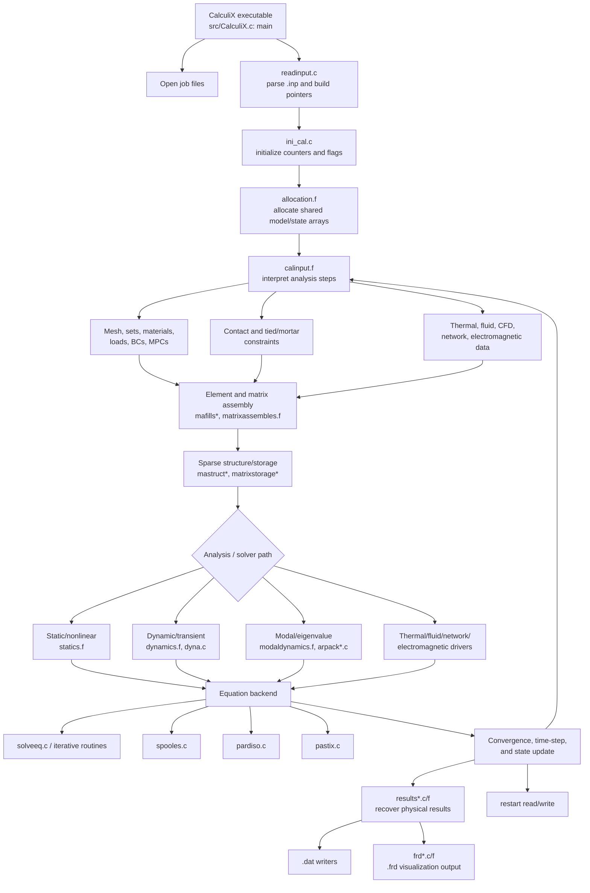
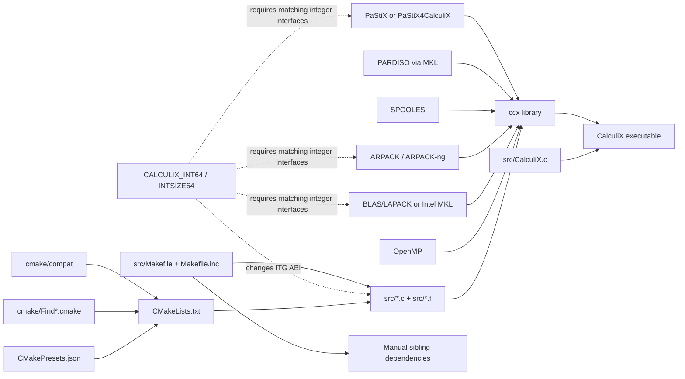
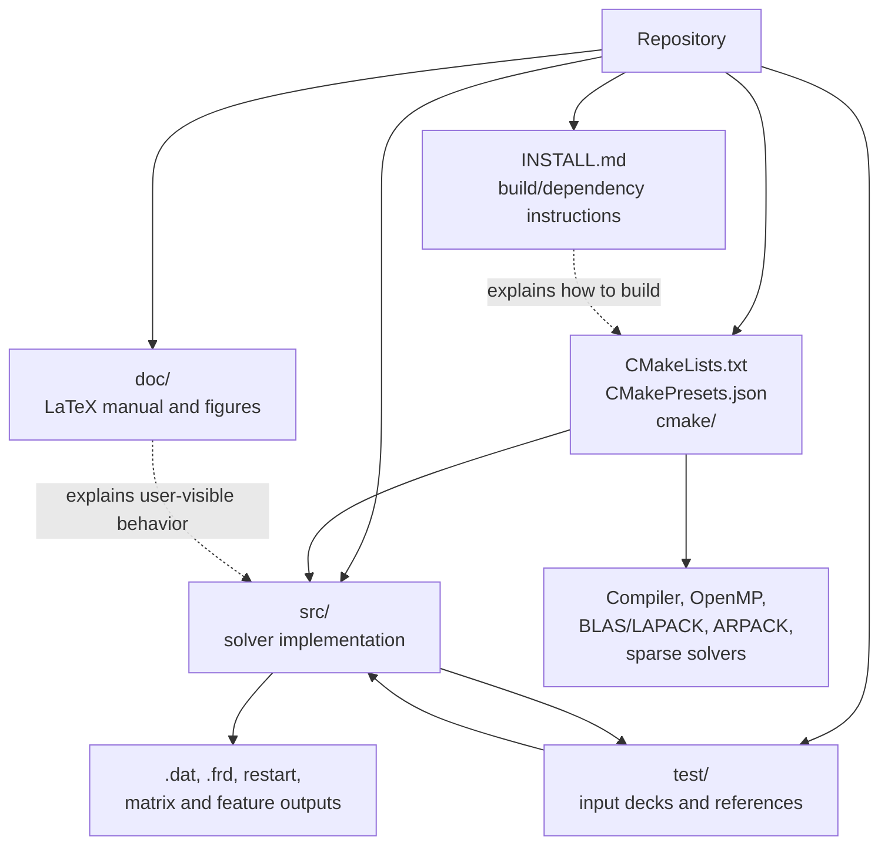

# CalculiX Relational Map

This map describes the principal relationships in the repository. It is
intentionally organized around runtime data flow and build-time dependencies,
because the implementation is a large flat C/Fortran source tree rather than
a package hierarchy.

## Runtime and data-flow map

## Build and dependency map

## Repository relationship map

## Key relationship notes

| Relationship | Meaning |
| --- | --- |
| `CalculiX.c` → shared arrays | The executable owns most model and solution state and passes it through broad C/Fortran interfaces. |
| `CalculiX.h` ↔ Fortran routines | The header defines naming, integer-size, allocation, and function-signature conventions for the language boundary. |
| `calinput.f` → analysis drivers | Input keywords select and configure static, dynamic, modal, coupled-physics, and specialized procedures. |
| Assembly → solver adapter | Matrix structure and values are prepared once per required phase, then passed to an iterative or external sparse backend. |
| Solver/update → results | Converged state is postprocessed into physical quantities before file writers emit user-facing results. |
| `CMakeLists.txt` → optional adapters | Build flags determine which external solver implementation is compiled and linked. |
| `test/*.inp` ↔ `.ref` files | Regression cases define expected numerical and output behavior for the executable. |
| `CalculiXstep.c` ↔ core routines | The embedding-style API shares the same numerical machinery but preserves state across caller-driven step invocations. |
